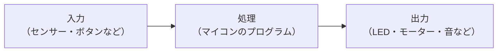

# 0. マイコンとは？

## このステップでやること

これから使う「マイコン」がどのようなもので、何ができるのかを知ります。
まだ手は動かしません。読みながら、自分なら何を作りたいかを考えてみてください。

## マイコンとは

**マイコン**（マイクロコントローラー）は、**小さなコンピューター**です。
PC と同じように CPU やメモリを持ち、さらに **外部の部品とつなぐための端子（ピン）** を備えています。これらが指先ほどの1つのチップにまとまっています。

ピンに LED やセンサー、モーターをつないでプログラムを書けば、

- ボタンが押されたら LED を光らせる
- 温度を測り、暑くなったらファンを回す
- スマホから操作してモーターを動かす

といったことができます。

!!! mame "マイコンという略称"
    もともと「マイコン」は **マイクロコンピューター** の略で、1970〜80年代には家庭用の小型コンピューターを指していました。
    お隣のサークル「MCC（Micro Computer Club）」の名前も、この意味のマイコンです。
    現在では、機器に組み込んで使う **マイクロコントローラー** を指すのが一般的です。英語では MCU（Micro Controller Unit）とも呼ばれます。

## 身の回りのマイコン

マイコンは、身の回りの多くの電化製品に組み込まれています。

| 製品 | マイコンの役割 |
|---|---|
| エアコン | 室温を測り、設定温度になるように風量を調整する |
| 炊飯器 | 温度を測りながら、火加減とタイマーを管理する |
| テレビのリモコン | 押されたボタンに応じて、赤外線の信号を出す |
| 洗濯機 | 水量やドアの開閉を検知しながら、モーターを回す |
| 自動車 | エンジン制御、エアバッグ、ブレーキなど。1台に数十個が搭載されている |

## PC との違い

| | PC | マイコン |
|---|---|---|
| 得意なこと | さまざまなソフトを動かす | 決まった1つの処理を継続して行う |
| 性能 | 高い | 低い（制御用途には十分） |
| 消費電力 | 大きい | 非常に小さい（電池で動く） |
| 大きさ・価格 | 大きい・高い | 小さい・安い（数百円〜） |
| 外部の部品との接続 | USB など | ピンで直接、LED やセンサーをつなげる |
| プログラム | OS の上でアプリケーションを動かす | 書き込んだプログラムだけが、電源が入っている間ずっと動く |

## マイコンの考え方：入力 → 処理 → 出力

マイコンでものを作るときは、**入力**・**処理**・**出力**の3つに分けて考えると整理しやすくなります。

たとえば「暗くなると自動で点灯するライト」なら、次のようになります。

- **入力**：明るさセンサーで周囲の明るさを測る
- **処理**：明るさがしきい値より暗いかをプログラムで判定する
- **出力**：暗ければ LED を点灯する

マイコンのプログラムは、この「入力 → 処理 → 出力」を **電源が入っている間、高速に繰り返し実行します**。

## ESP32 とは

この講座では、**ESP32** というマイコンを使います。中国の Espressif 社が開発しているマイコンで、電子工作で広く使われています。

- **Wi-Fi と Bluetooth を内蔵している**：スマホから操作したり、ネットワークにつないだりできる
- **性能が高い**：マイコンとしては高速で、使えるピンも多い
- **安い**：ボード1枚が千円前後
- **情報が多い**：利用者が多いので、調べれば大抵の問題の解決策が見つかる

!!! mame "前身の ESP8266"
    ESP32 の前に、Espressif は **ESP8266** という Wi-Fi チップを出していました。本来は「他のマイコンに Wi-Fi 機能を追加するための部品」でしたが、安価なうえに単体でプログラムも動かせたため、世界中の電子工作で広く使われました。
    その後継として、性能を上げて Bluetooth も搭載したのが ESP32 です。現在では ESP32-S3 や ESP32-C3 など、多くの派生品があります。

## この講座で使うボード

マイコンのチップ単体では扱いにくいので、USB 端子やピンを付けて使いやすくした **開発ボード** を使います。
この講座では、Freenove の ESP32 ボードを使います。

!!! todo "画像：Freenove ESP32 ボードの写真（各部の名前を書き込む）"

| 部分 | 役割 |
|---|---|
| ESP32 モジュール（銀色の金属カバー） | マイコン本体。Wi-Fi / Bluetooth のアンテナも含む |
| USB 端子 | PC とつないで、プログラムの書き込みと電源の供給を行う |
| ピン（両側に並んでいる端子） | LED やセンサーなどの部品をつなぐ |
| EN（RST）ボタン | 押すとマイコンが再起動する |
| BOOT ボタン | 書き込みがうまくいかないときに使う |

次は [1. 環境構築](../01-basics/01-setup.md) で、PC から ESP32 にプログラムを書き込めるようにします。
