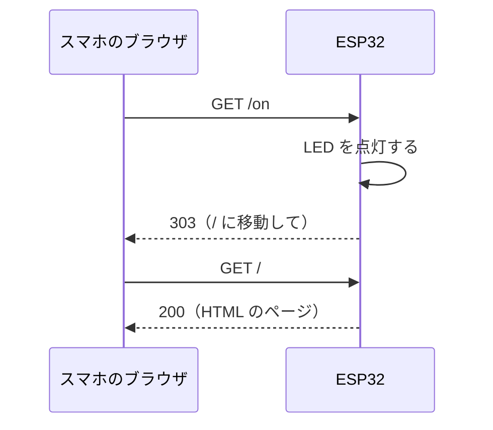

# Wi-Fi（Web サーバ）

## このステップでやること

ESP32 を Wi-Fi のアクセスポイント兼 Web サーバにして、スマホのブラウザから LED を操作します。
アプリを作らなくても、ブラウザさえあればどの端末からでも操作できるのが利点です。

!!! todo "画像：スマホのブラウザに操作画面が表示されている様子"

## 前提ステップ・使う部品

- 前提：第1部
- 部品：
    - ステップ2の LED の回路（GPIO13 → 抵抗 → LED → GND）
    - スマホ（または PC）

## Wi-Fi のつなぎ方

ESP32 の Wi-Fi には、2 つの使い方があります。

| モード | 動作 | 向いている場面 |
|---|---|---|
| **アクセスポイント（AP）モード** | ESP32 が自分で Wi-Fi のネットワークを作る。スマホがそこにつなぐ | Wi-Fi のない場所、学内ネットワークが使えない場所 |
| **ステーション（STA）モード** | ESP32 が既存の Wi-Fi ルーターにつなぐ | インターネットを使いたいとき |

大学の Wi-Fi は、ID とパスワードで認証する方式（WPA2 エンタープライズ）のことが多く、ESP32 から簡単にはつなげません。そこでこの講座では、AP モードを使います。

## コード

```cpp title="src/main.cpp"
#include <Arduino.h>
#include <WiFi.h>
#include <WebServer.h>

const int LED_PIN = 13;

// ほかの人と重ならない名前にする
const char *SSID = "ESP32-yourname";
const char *PASSWORD = "esp32pass";  // 8 文字以上

WebServer server(80);  // 80 番ポートで待ち受ける
bool ledOn = false;

// ブラウザに返す HTML を作る
String makePage() {
  String html = R"rawliteral(
<!DOCTYPE html>
<html>
<head>
  <meta charset="utf-8">
  <meta name="viewport" content="width=device-width, initial-scale=1">
  <title>ESP32 LED</title>
  <style>
    body { font-family: sans-serif; text-align: center; }
    a { display: inline-block; margin: 8px; padding: 16px 32px;
        color: white; background: #c62828; border-radius: 8px; text-decoration: none; }
  </style>
</head>
<body>
  <h1>ESP32 LED</h1>
)rawliteral";
  html += "<p>LED: ";
  html += ledOn ? "ON" : "OFF";
  html += "</p>";
  html += R"rawliteral(
  <a href="/on">ON</a>
  <a href="/off">OFF</a>
</body>
</html>
)rawliteral";
  return html;
}

void handleRoot() {
  server.send(200, "text/html", makePage());
}

void handleOn() {
  ledOn = true;
  digitalWrite(LED_PIN, HIGH);
  server.sendHeader("Location", "/");  // トップページに戻す
  server.send(303);
}

void handleOff() {
  ledOn = false;
  digitalWrite(LED_PIN, LOW);
  server.sendHeader("Location", "/");
  server.send(303);
}

void setup() {
  Serial.begin(115200);
  pinMode(LED_PIN, OUTPUT);

  WiFi.softAP(SSID, PASSWORD);  // AP モードで Wi-Fi を始める
  Serial.print("IP address: ");
  Serial.println(WiFi.softAPIP());  // 通常は 192.168.4.1

  // URL ごとに、呼び出す関数を登録する
  server.on("/", handleRoot);
  server.on("/on", handleOn);
  server.on("/off", handleOff);
  server.begin();
}

void loop() {
  server.handleClient();  // ブラウザからのリクエストを処理する
}
```

## 動かしてみる

1. `SSID` を自分の名前などに変えてから書き込む（周りの人と同じ名前にしない）
2. シリアルモニタに `IP address: 192.168.4.1` と表示されることを確認する
3. スマホの Wi-Fi 設定で、`ESP32-yourname` を選び、パスワード `esp32pass` でつなぐ
4. スマホのブラウザで `http://192.168.4.1` を開く
5. 「ON」「OFF」を押して、LED が切り替わることを確認する

!!! note "「インターネットに接続されていません」と表示される"
    ESP32 の Wi-Fi はインターネットにつながっていないので、スマホによっては警告が出たり、自動でモバイル通信に切り替わったりします。「このまま接続する」を選ぶか、一時的にモバイルデータ通信をオフにしてください。

## 仕組み

ブラウザで `http://192.168.4.1/on` を開くと、ブラウザは ESP32 に「`/on` のページをください」という **HTTP リクエスト** を送ります。
ESP32 は、`server.on("/on", handleOn)` で登録した関数を呼び出し、LED を点灯させてから、トップページ（`/`）に移動するよう返事をします。



!!! mame "生文字列リテラル"
    コードの中の `R"rawliteral(...)rawliteral"` は、C++ の **生文字列リテラル** という書き方です。`R"区切り(` と `)区切り"` の間に書いた文字列は、改行や `"` をそのまま含められます。HTML のように `"` が多い文字列を書くときに便利です。

!!! mame "ステータスコード"
    `server.send(200, ...)` の `200` は、HTTP の **ステータスコード** で、「成功」を表します。`303` は「別のページを見に行ってください」、よく見かける `404` は「ページが見つからない」という意味です。

## 発展課題

- [ ] [6. アナログ入力](../01-basics/06-analog.md) の回路を追加し、可変抵抗の値をページに表示する（ページを再読み込みすると値が更新される）
- [ ] LED の明るさを 4 段階で切り替えられるボタンを追加する
- [ ] STA モードで、スマホのテザリングにつないで動かす（ヒント：`WiFi.begin(ssid, password)`）

## うまくいかないとき

??? question "スマホの Wi-Fi の一覧に表示されない"
    - シリアルモニタに IP アドレスが表示されているか確認してください
    - パスワードが 8 文字未満だと、AP の作成に失敗します

??? question "ブラウザでページが開かない"
    - スマホが ESP32 の Wi-Fi につながっているか確認してください
    - `https://` ではなく `http://` で開いてください
    - モバイルデータ通信をオフにしてから、もう一度試してください

## チェックポイント

!!! success "チェックポイント"
    スマホのブラウザから LED を操作できたら、先輩に見せて進捗表にチェックをもらってください。
