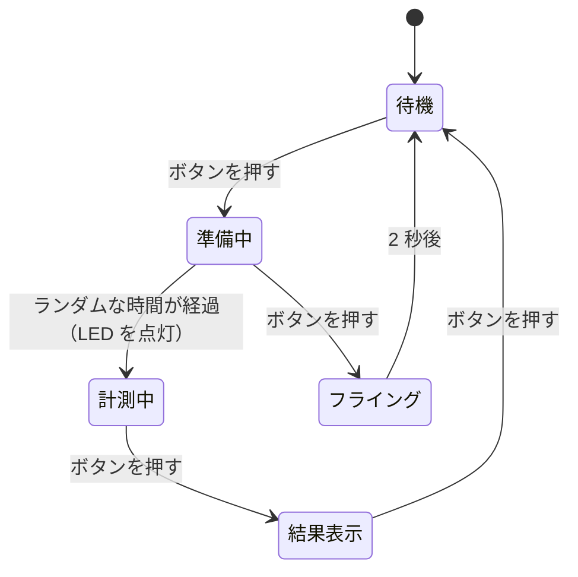

# ミニ製作

## このステップでやること

これまでに学んだことを組み合わせて、自分で考えた作品を1つ作ります。
講座の最終目標は、作りたいものに必要な部品やコードを **自分で調べながら作れる** ようになることです。このステップでは、その手順を一通り経験します。

## 前提ステップ・使う部品

- 前提：第1部、および作品に必要な第2部のステップ
- 部品：作品に合わせて選びます。部室にない部品が必要な場合は、先輩に相談してください

## 手順1：作るものを決める

[0. マイコンとは？](../00-intro/index.md) で考えた「作りたいもの」を見直し、**1〜2 週間で完成できる大きさ** に絞り込みます。

最初の作品は、機能を欲張らないことが大切です。「最低限これができれば完成」という機能を決め、ほかの機能は完成したあとに追加しましょう。

作品の例：

| 作品 | 使う技術 |
|---|---|
| 温湿度計 | I2C センサー、OLED ディスプレイ |
| スマホで操作できる照明 | Wi-Fi または BLE、PWM |
| 反応速度ゲーム（LED が光ったら素早くボタンを押す） | ボタン入力、`millis()`、OLED ディスプレイ |
| 自動で開くゴミ箱 | 距離センサー、サーボモーター |
| ラジコンカー | DC モーター、ESP-NOW |
| 学習リモコン | 赤外線の送受信、Wi-Fi |

## 手順2：入力・処理・出力に分ける

作品を「入力・処理・出力」に分けて書き出します。

```
作品：反応速度ゲーム

入力：ボタン
処理：ランダムな時間待ってから LED を点灯し、ボタンが押されるまでの時間を測る
出力：LED、OLED ディスプレイ（測った時間を表示する）
```

処理が複雑な場合は、[7. delay を使わない書き方](../01-basics/07-millis.md) で説明した状態遷移の図を描くと整理できます。



## 手順3：部品を調べる

必要な部品が講座で扱っていないものの場合は、次のことを調べます。

- **部品の型番**：同じ「距離センサー」でも、超音波式（HC-SR04）や赤外線式（VL53L0X）などがある
- **電源電圧**：3.3 V で動くか。5 V の部品は、そのまま ESP32 につなげないことがある
- **通信方式**：デジタル入出力、アナログ、I2C など、どうやって ESP32 とつなぐか
- **ライブラリ**：PlatformIO のライブラリ検索で、その部品用のライブラリがあるか

!!! tip "調べ方"
    「部品の型番 ESP32」や「部品の型番 Arduino」で検索すると、使い方の解説やサンプルが見つかります。Arduino 向けのコードも、多くは ESP32 でそのまま、または少し直すだけで使えます。
    部品のデータシートは、販売店のページからダウンロードできることが多いです。

## 手順4：部品ごとに動作を確認する

いきなり全部を組み合わせると、うまく動かないときにどこが原因かわからなくなります。**部品を1つずつ、単独で動作確認** してから組み合わせてください。

1. 部品ごとに、動作を確認するだけの短いプログラムを書く
2. すべての部品が単独で動くことを確認する
3. 1つずつ組み合わせていく。組み合わせるたびに動作を確認する

## 手順5：形にする

動作を確認できたら、作品として形にします。

- 回路を基板にまとめる（[回路を作る](board.md)）
- 電池で動くようにする（[電源](power.md)）
- ケースを作る（段ボール、木材、アクリル板、3D プリンタなど）

## 手順6：発表する

完成したら、部室で作品を発表します。

- 何を作ったか、どう動くか
- 使った技術・部品
- 苦労したところ、工夫したところ
- 次に追加したい機能

ほかの人の作品を見ることで、自分では思いつかなかった技術や工夫を知ることができます。

## チェックポイント

!!! success "チェックポイント"
    作品が完成したら、部室で発表して進捗表にチェックをもらってください。これで講座は修了です。
